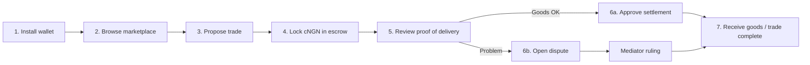
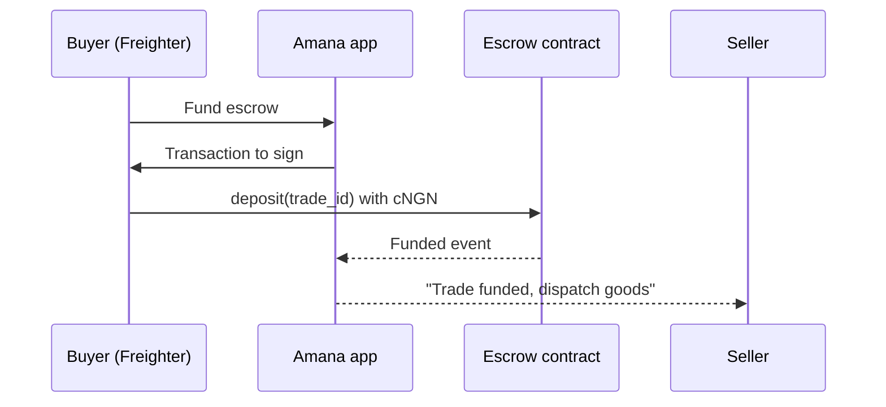
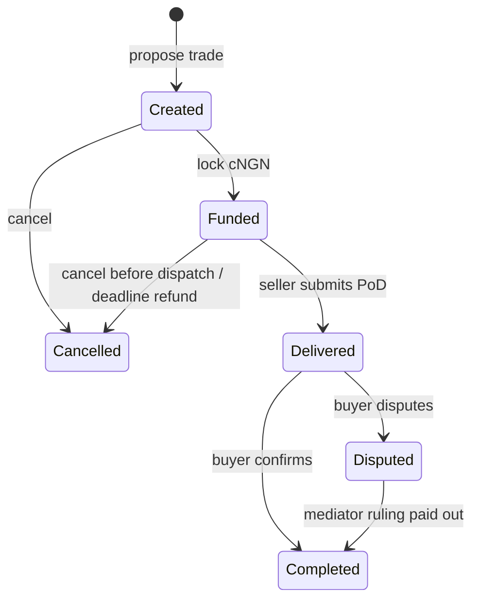

# Buyer Guide: Buying Through Amana Escrow

This guide is for **buyers**: food processors, aggregators and traders who
purchase produce on the Amana marketplace. It walks you through the whole
process, from setting up a wallet to receiving your goods, so you do not need
the seller to explain it.

**What escrow means for you:** your payment is locked in a smart contract, not
sent to the seller. The seller is paid only after you approve the delivery,
or after a mediator settles a dispute.

## At a glance

| Step | What you do | What the contract does |
|---|---|---|
| 1 | Install a Stellar wallet and fund it | Nothing yet |
| 2 | Find a listing and check the seller's trust score | Nothing yet |
| 3 | Propose quantity, price, deadline and loss ratio | `create_trade` records the terms |
| 4 | Deposit cNGN (or pay with another asset) | `deposit` / `deposit_with_path` locks funds |
| 5 | Check the seller's manifest, photos and video | Evidence is linked to the trade |
| 6 | Approve, or dispute | `confirm_delivery` + `release_funds`, or `initiate_dispute` |
| 7 | Take delivery and close out | Trade becomes `Completed` |

---

## Step 1: Install and set up a wallet

Amana uses the Stellar network. You need a Stellar wallet that can sign
Soroban transactions. We recommend **Freighter** (browser extension).

1. Install Freighter from [freighter.app](https://www.freighter.app/) for
   Chrome, Brave or Firefox.
2. Create a new wallet and **write down the 12-word recovery phrase on paper**.
   Amana staff will never ask for it. Anyone who has it controls your funds.
3. Fund the wallet with a small amount of **XLM** (at least 5 XLM) to pay for
   network fees and account reserves.
4. **Add a cNGN trustline.** In Freighter: *Manage assets → Add asset → search
   "cNGN"* and confirm. Without a trustline your account cannot hold cNGN.
5. Get cNGN from a supported on-ramp or exchange. You can also pay with
   another asset (e.g. USDC or XLM) and let Amana convert it to cNGN through a
   Stellar path payment in Step 4.
6. Open Amana, click **Connect wallet**, and approve the connection in
   Freighter.

> 📸 *Screenshot: Freighter "Add asset" screen with cNGN selected*
> (`docs/images/buyer-guide/01-add-trustline.png`)

**Check before moving on:** the Amana header shows your shortened wallet
address and your cNGN balance.

## Step 2: Browse the marketplace

1. Go to **Marketplace** in the sidebar.
2. Filter by commodity, location, quantity and delivery window.
3. Open a listing and check:
   - **Trust score (0–100).** Based on completed trades, lost disputes,
     on-time delivery and settled volume. See
     [ADR-009](adr/ADR-009-trust-score-algorithm.md). A score of 0 with a
     "new trader" label means no history yet, not a bad history.
   - **Grade, quantity and unit price.**
   - **Delivery terms:** location, deadline, who pays transport.

> 📸 *Screenshot: listing detail with trust score and delivery terms*
> (`docs/images/buyer-guide/02-listing.png`)

**Tip:** for a first trade with a new or low-score seller, start with a
smaller quantity.

## Step 3: Propose a trade

1. On the listing, click **Propose trade**.
2. Fill in:
   - **Quantity** and **agreed price** (in cNGN).
   - **Delivery deadline.** After it passes without delivery, you can claim
     a refund.
   - **Loss ratio.** How a loss is split if goods are partly spoiled or
     short. For example, a buyer/seller split of 30/70 means you carry 30% of
     any agreed loss. See [ADR-002](adr/ADR-002-escrow-loss-sharing-model.md).
     Low-trust sellers may require the seller to carry more.
3. Review the summary, including the platform fee, and click **Submit
   proposal**. Freighter will ask you to sign. This records the terms on
   chain but **does not move money yet**.
4. Wait for the seller to accept. You will get a notification. The trade
   status becomes **Created**.

> 📸 *Screenshot: Propose trade form with loss-ratio slider*
> (`docs/images/buyer-guide/03-propose-trade.png`)

## Step 4: Lock cNGN in escrow

1. Open the trade from **Trades** and click **Fund escrow**.
2. Choose how to pay:
   - **cNGN:** the amount is sent directly to the escrow contract.
   - **Another asset:** Amana quotes a path payment that converts to the
     exact cNGN amount. Check the quoted maximum you will spend.
3. Sign in Freighter.
4. When the transaction confirms, the status becomes **Funded**. The seller
   is notified and can now dispatch the goods.

**Your funds are now held by the contract.** Neither the seller nor Amana
can spend them. Before the seller dispatches, you can cancel and get a full
refund with **Cancel trade**.

> 📸 *Screenshot: trade page showing "Funded" status and escrow amount*
> (`docs/images/buyer-guide/04-funded.png`)

## Step 5: Review the proof-of-delivery (PoD) evidence

When the seller dispatches and delivers, they upload evidence to the trade:

- **Manifest:** driver, vehicle, items, weights and dispatch time. Some
  driver details are masked for privacy.
- **Photos and video proof** of the goods at dispatch and at delivery.
- **Delivery timestamp,** compared against your deadline.

Open the trade and go to the **Evidence** tab. Compare the evidence with what
physically arrived:

- [ ] Quantity and weight match the manifest
- [ ] Grade and quality match the listing
- [ ] Packaging is intact and there is no spoilage
- [ ] Delivered on or before the deadline

> 📸 *Screenshot: Evidence tab with manifest and video proof*
> (`docs/images/buyer-guide/05-evidence.png`)

## Step 6a: Approve settlement

If everything is correct:

1. Click **Confirm delivery** and sign in Freighter.
2. The contract releases the escrowed cNGN to the seller, minus the platform
   fee. Status becomes **Completed**.

If only part of the order arrived, use **Accept partial delivery** to pay
for what you received. The rest is handled according to the agreed terms.

**Approval cannot be undone.** Confirm only after inspecting the goods.

## Step 6b: Open a dispute

If the goods are short, damaged, wrong, or did not arrive:

1. Click **Open dispute**, choose a reason, and describe the problem.
2. **Upload your own evidence:** photos of the goods on arrival, weighbridge
   tickets, and any messages with the seller.
3. Sign in Freighter. Status becomes **Disputed** and the funds stay locked.
4. A mediator reviews both sides and rules what share each party gets. The
   contract pays out according to that ruling and your loss ratio.

## Step 7: Receive goods and close out

- Once the trade is **Completed**, it appears in your trade history with the
  on-chain transaction links.
- Your trust score and the seller's are updated within about one minute.
- If the seller never delivers and the deadline passes, open the trade and
  click **Claim refund** to get your cNGN back.

---

## Common errors and how to fix them

| Message you see | What it means | How to fix it |
|---|---|---|
| **"Freighter is not installed"** / **Connect wallet does nothing** | The extension is missing or disabled. | Install or enable Freighter and reload the page. |
| **"User declined access"** | You rejected the connection or signing popup. | Click **Connect wallet** again and approve in Freighter. |
| **"Wrong network"** / **"Network passphrase mismatch"** | Freighter is on Testnet and Amana is on Mainnet, or the other way round. | In Freighter, *Settings → Network*, choose the network shown in the Amana header. |
| **`op_no_trust`** | Your account has no cNGN trustline. | Add the cNGN trustline (Step 1.4). |
| **`op_underfunded`** / **"Insufficient balance"** | Not enough cNGN to cover the trade amount. | Top up cNGN, or pay with another asset through a path payment. |
| **`tx_insufficient_balance`** / **"below minimum reserve"** | Not enough XLM for fees and account reserves. | Add at least 2–5 XLM to your wallet. |
| **`op_too_few_offers`** / **"No path found"** | The path payment cannot convert your asset to cNGN at the quoted rate. | Retry. If it keeps failing, pay in cNGN directly or use a more liquid asset such as USDC or XLM. |
| **`tx_bad_seq`** | Two transactions were signed at the same time. | Wait a few seconds, refresh the page, and try again. |
| **`tx_too_late`** / **"Transaction expired"** | The transaction was signed too long after it was built. | Click the action again and sign promptly. |
| **"Trade is not in Funded status"** | You tried to confirm, dispute or cancel in the wrong state (e.g. already completed). | Refresh the trade page and check its current status. |
| **"Contract is paused"** | Admins paused the escrow for maintenance or an incident. | Funds are safe. Wait for the status banner to clear, then retry. |
| **"Deadline has not passed"** when claiming a refund | The refund is only available after the delivery deadline. | Wait until the deadline, or ask the seller to agree to cancel. |

If an error is not listed here, copy the full message and the trade ID from
the trade page and contact support. **Never share your recovery phrase.**

## Related documents

- [ADR-002: Escrow loss-sharing model](adr/ADR-002-escrow-loss-sharing-model.md)
- [ADR-009: Trust score algorithm](adr/ADR-009-trust-score-algorithm.md)
- [Trade lifecycle](architecture/trade-lifecycle.md)
- [Dispute flow](architecture/dispute-flow.md)
